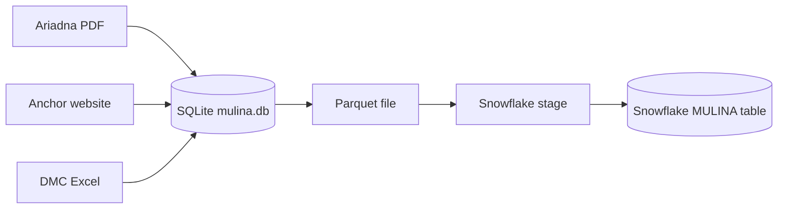
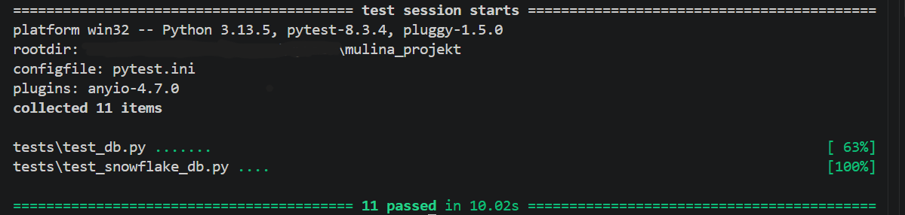
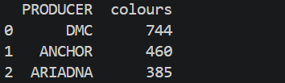
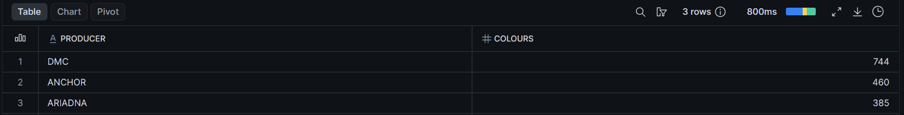

# Mulina ETL

A small data pipeline that collects embroidery thread (mouliné) colour codes from three different sources, cleans them, stores them in SQLite and loads them into Snowflake. Automated data quality checks compare both databases.

## Why this project

Thread producers (DMC, Anchor, Ariadna) publish their colour codes in different formats: a PDF leaflet, a web page and an Excel file. The goal was to build one clean, deduplicated table and use it to store all the possible colours so then I can keep track of the ones I own, the ones I need for my embroidery projects. 

## Data flow



## Tech stack

- **Python**: pdfplumber (PDF), requests + BeautifulSoup (web scraping), openpyxl (Excel), pandas + pyarrow (Parquet)
- **SQLite**: local database
- **Snowflake**: cloud warehouse (`PUT` to an internal stage, `COPY INTO`)
- **pytest**: data quality checks
- **python-dotenv**: credentials kept outside the code

## How it works

The pipeline runs locally in four steps:

1. ['get_codes_from_pdf_Ariadna.py'](src/get_codes_from_pdf_Ariadna.py) extracts 4-digit codes (optionally with a trailing letter) from the Ariadna PDF leaflet with a regular expression.
2. ['get_codres_from_web_Anchor.py'](src/get_codres_from_web_Anchor.py) scrapes colour codes and names from the Anchor product page.
3. ['get_codes_from_excel_DMC.py'](src/get_codes_from_excel_DMC.py) reads the DMC colour chart from Excel, skips header and note rows, and removes `*` and `^` markers from codes.
4. ['upload_data_into_snowflake.py'](src/upload_data_into_snowflake.py) exports the table to Parquet, uploads it to a Snowflake stage and loads it with `COPY INTO`.

Every script cleans the data (trimmed, uppercase codes, no trailing markers) and writes with an upsert, so re-running it does not create duplicates.

Source files and credentials are not included in the repository.

## Project structure

```
mulina_projekt/
├── README.md
├── requirements.txt              # Python dependencies
├── pytest.ini                    # pytest settings and markers
├── .env.example                  # required environment variables (no secrets)
├── .gitignore
├── sql/
│   ├── create_table_mulina.py             # local table definition
│   ├── create_table_mulina_snowflake.py   # Snowflake table and stage
│   └── analysis.py                        # analysis queries
├── src/
│   ├── get_codes_from_pdf_Ariadna.py      # PDF leaflet -> SQLite
│   ├── get_codres_from_web_Anchor.py      # Anchor web page -> SQLite
│   ├── get_codes_from_excel_DMC.py        # DMC Excel chart -> SQLite
│   └── upload_data_into_snowflake.py      # SQLite -> Parquet -> Snowflake
├── tests/
│   ├── test_db.py                 # SQLite data quality checks
│   └── test_snowflake_db.py       # SQLite vs Snowflake checks
└── docs/
    ├── pytest_results.png         # test run screenshot
    ├── query_results.png          # query result screenshot
    └── snowflake_result.png       # query in Snowflake result screenshot
```

## Data model

| Column   | Description                                       |
|----------|---------------------------------------------------|
| PRODUCER | `DMC`, `ANCHOR` or `ARIADNA`                      |
| CODE     | Colour code, uppercase text (e.g. `310`, `B5200`) |
| COLOUR   | Colour name (not available for Ariadna)           |

`(PRODUCER, CODE)` is unique in SQLite. Snowflake does not enforce unique constraints, so duplicates there are prevented in the load step and verified by tests. Table definitions are in ['create_table_mulina.py'](sql/create_table_mulina.py).

## Data quality checks

Tests run against my local SQLite database and my Snowflake account. They are included to show the checks and are not meant to be run from a fresh clone.

```bash
pytest                  # SQLite checks
pytest -m integration   # SQLite vs Snowflake checks
```

Checked in SQLite:
- no duplicate `(PRODUCER, CODE)` pairs
- no empty codes, all codes uppercase, no trailing `*` or `^`
- every producer has rows; DMC and Anchor rows have colour names

Checked in Snowflake:
- row counts and row content match SQLite
- no duplicates
- no empty codes, all codes uppercase, no trailing `*` or `^`



## Example results

Queries are in [`sql/analysis.py`](sql/analysis.py).

**Colours per producer**





The result shows number of colour codes per producer

## Design decisions and lessons learned

- **Upsert instead of plain insert**: scripts can be re-run safely and colour names get refreshed.
- **Parquet for the Snowflake load**: it keeps column types and loads much faster than row-by-row inserts.
- **Tests caught a real problem**: the SQLite vs Snowflake comparison found 76 DMC rows in Snowflake that had been loaded before the cleaning step (codes like `3684*`). I reloaded the table from the cleaned database (OVERWRITE=TRUE parameter) and the checks passed.
- **One statement per `execute`**: the Snowflake connector rejects multi-statement strings, so stage creation, `PUT` and `COPY INTO` are separate calls.
- **Credentials**: stored in `.env` (not committed); `.env.example` lists the required variables.

## Data sources and disclaimer

The repository contains no source data. Codes come from publicly available materials: the Ariadna leaflet, the Anchor product page and the DMC colour chart. The Anchor scraper is for educational purposes only. Anchor's website's terms of use do not explicitly address automated access. This project is not affiliated with DMC, Anchor or Ariadna.

## Possible next steps

The thread catalogue is the foundation for a personal embroidery tracker:

- **Inventory**: a table of the threads I own (producer, code, number of skeins), so suggestions can be split into "in stock" and "to buy".
- **Projects and shopping list**: link projects to the threads they need and list what is missing from stock.
- **Colour values**: add RGB/hex columns to the catalogue for each producer and code, so threads can be compared by actual colour instead of by name.
- **Colour matching across producers**: find the closest thread from another producer by colour distance, replacing the name-based DMC ↔ Anchor matching.
- **Thread suggestions from images**: extract the dominant colours from a picture (a photo or a pattern image) and map each one to the nearest threads in the catalogue, to see which threads a project needs.
